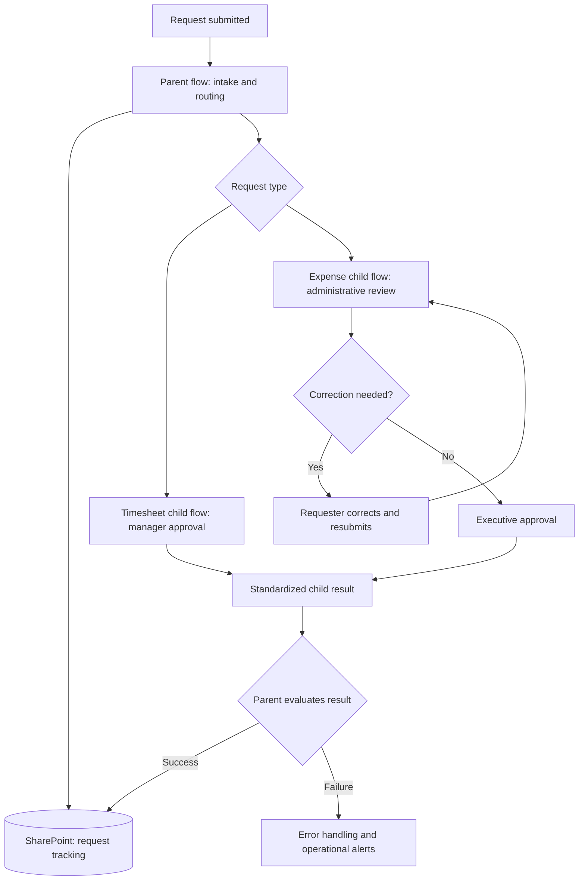

# 🧩 Power Platform Business Process Governance & Automation Framework Architecture

**Institution:** Foresight Atlantic Inc.  
**Duration:** 2026 – Present  
**Role:** General Manager / Business Process Automation Analyst  
**Technology:** Power Automate · SharePoint Lists · Microsoft Forms · Approvals · Outlook · Microsoft Teams   
**Confidentiality:** This documentation-only case study describes architecture, business process design, governance practices, and technical decisions. It does not share company data, actual flow definitions, credentials, internal URLs, identifiers, or sensitive records.

---

## 📌 Project Overview

A reusable Microsoft 365 and Power Platform framework for request intake, approval routing, correction and resubmission, business-level tracking, and operational monitoring. Its first use cases were **timesheet** and **expense claim** approvals.

**Three principles guided the work:**

1. **Design for reuse:** Build a common automation foundation rather than isolated workflows.
2. **Embed governance:** Make ownership, traceability, monitoring, and maintainability part of the design.
3. **Start with the business process:** Adapt the technology to the rules and needs of each workflow—not the other way around.

---

## 🎯 Business Problem - STAR

### Situation

Timesheets were signed on paper, while expense claims circulated as spreadsheets via email without a formal, centralized approval trail. Employees needed a simple experience; the organization needed consistent routing, visibility, reliable attachment handling, and controls for corrections and exceptions.

### Task

Design and implement a maintainable framework that digitizes the initial approval processes while establishing a reusable pattern for future internal services, with stronger governance and business-level traceability.

### Action

- **Analyzed and redesigned approval processes**, translating different business rules into timesheet and expense workflows.
- **Established a modular parent–child flow pattern** to centralize shared intake and orchestration while isolating process-specific approval logic.
- **Implemented business controls** for request status, multi-level approvals, correction and resubmission, and safeguards against duplicate processing.
- **Standardized operational monitoring**, including error-handling scopes, structured flow responses, and Teams/email alerts.
- **Introduced governance practices** covering naming conventions, service-account connections, connection references, and solution organization.
- **Validated end-user permissions** through end-to-end testing with user credentials rather than relying solely on administrator access.

### Results & business value

- Replaced paper timesheet sign-off with a traceable digital approval process.
- Established a formal two-level expense approval process with a controlled correction and resubmission loop.
- Created a common architecture that can support additional approval processes without rebuilding shared intake logic.
- Improved visibility of request status and exceptions through SharePoint tracking and operational alerts.
- Established reusable governance and maintenance practices for future automation initiatives.

*Quantified outcomes such as approval turnaround time, hours saved, or request volumes have not yet been established and are not claimed here.*

## Architecture overview

One **parent flow** handles everything the processes share. One **child flow** per business process handles only what is different. To add a new approval type, you add a new child flow.

The parent flow handles shared intake and routing; child flows implement the approval rules specific to each request type. The technical documentation explains the flow responsibilities and execution details.

## Key design decisions

| Decision | Business and operational rationale |
| --- | --- |
| Parent–child flows and standardized results | Reuse common logic and simplify future process additions. |
| SharePoint request tracking | Give business users visibility beyond technical run history. |
| Correction and resubmission controls | Support realistic exception paths without uncontrolled reprocessing. |
| Structured error handling and alerts | Make failures visible and easier to investigate. |
| Service-account and connection governance | Reduce reliance on individual employees and improve continuity. |
| Naming standards and solution organization | Improve maintainability and readiness for future lifecycle management. |
| Connector-specific attachment handling | Preserve usable files across Forms, SharePoint, Outlook, and Approvals. |

**Current architecture constraint:** DEV and PRD are logically distinguished within a single Power Platform environment; this is not equivalent to physically separated development and production environments.

## A consistent approach across generations of technology

Earlier in my career at the **Court of Accounts of Rio Grande do Sul (TCE-RS)**, I designed and automated business processes using Oracle Workflow and PL/SQL, combining AS-IS/TO-BE analysis, approval routing, legacy-system integration, and service-performance controls.

**The technology has evolved, but my approach to business process improvement remains the same:** understand the business, map the process, identify inefficiencies, redesign workflows, and use technology to deliver sustainable improvements.

The Power Platform framework applies those same principles using modern low-code tools, with additional emphasis on reusable architecture, governance, and operational support.

## Key competencies demonstrated

**Business and process:** Business Process Analysis · Workflow Redesign · Process Standardization · Stakeholder Collaboration · Continuous Improvement

**Architecture and delivery:** Power Automate · Parent–Child Workflow Design · SharePoint Lists · Microsoft 365 Integration · Approval Automation · Exception Handling

**Governance and operations:** IT Governance · Traceability · Service Account Strategy · Connection Governance · Naming Standards · Maintainability

## Lessons learned

- Low-code automation still requires business analysis and architectural discipline.
- Business users need process-level visibility; technical run history alone is insufficient.
- Error handling, connection ownership, and attachment compatibility should be designed early.

## Next steps

- Evaluate a Power Apps interface for request submission and tracking.
- Strengthen application lifecycle management, including environment separation and environment variables.
- Expand operational logs, retry handling, and reporting capabilities.

## Technical documentation

The README is the business-facing entry point. Supporting documents provide implementation-level detail:

| Topic | Documentation |
| --- | --- |
| Architecture and flow responsibilities | [`docs/architecture.md`](docs/architecture.md) |
| Approval workflows and correction logic | [`docs/approval-workflows.md`](docs/approval-workflows.md) |
| Attachment handling | [`docs/attachments.md`](docs/attachments.md) |
| State management and duplicate-run safeguards | [`docs/state-management.md`](docs/state-management.md) |
| Error handling and monitoring | [`docs/error-handling.md`](docs/error-handling.md) |
| Service accounts, connections, naming, and security | [`docs/governance.md`](docs/governance.md) |

*The linked documentation files are proposed repository structure and should be created before publishing these links.*

