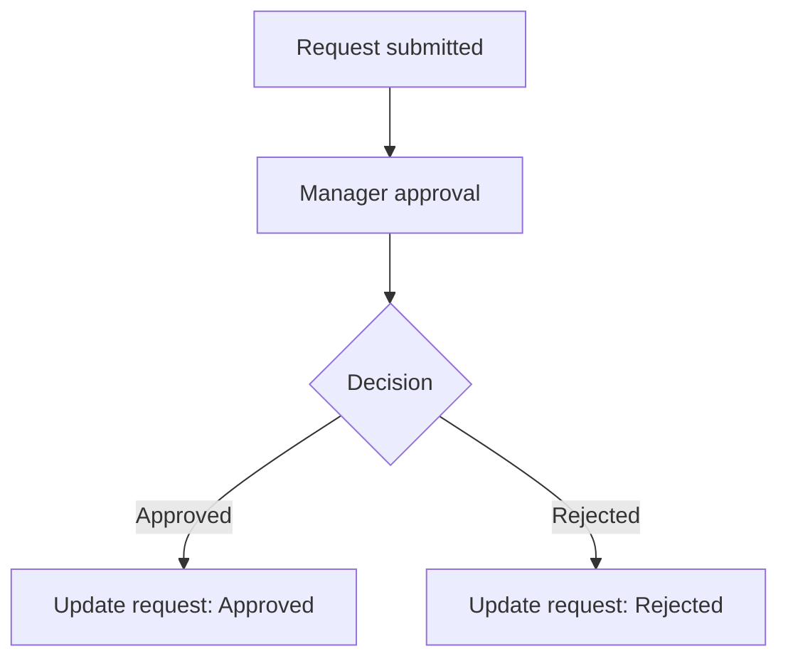
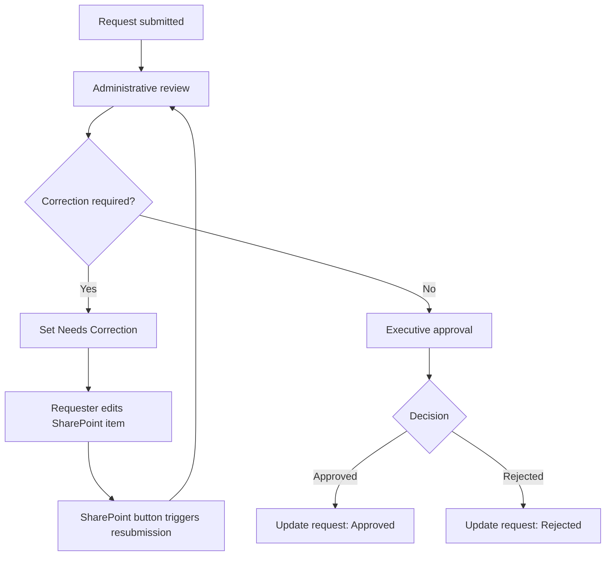

# Approval Workflows and Correction Logic

[← Back to project overview](../README.md)

## Business context

The original timesheet process relied on paper sign-off. Expense claims circulated as spreadsheets via email without a centralized formal approval trail. The automation replaces those fragmented interactions with defined business states and routing.

## Timesheet approval

The initial timesheet workflow has a direct manager approval and **no correction loop**.

## Expense approval

The correction path is controlled by SharePoint fields and a button-triggered update flow rather than unrestricted automatic reprocessing.

## Business statuses

| Status | Meaning |
| --- | --- |
| `Under Review` | Request is in the review/approval lifecycle. |
| `Needs Correction` | Requester action is needed before resubmission. |
| `Approved` | Business approval was granted. |
| `Rejected` | Business approval was declined. |

## Business and technical outcomes

A **business rejection** is not the same as a **technical flow failure**. The child-flow `result` / `message` contract is intended for execution feedback, while SharePoint status captures the request's business outcome.

## Value of differentiated approval paths

The two processes use the same architectural foundation without forcing identical rules. This preserves usability for straightforward requests while supporting more controlled review and correction for expenses.

## Related documentation

- [Architecture](architecture.md)
- [State management](state-management.md)
- [Attachment handling](attachments.md)
