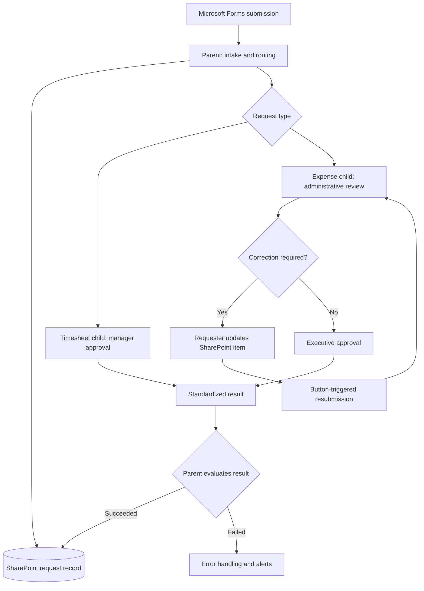

# Framework Architecture and Flow Responsibilities

[← Back to project overview](../README.md)

## Purpose

The framework provides a reusable approach for internal request intake, approval orchestration, business-status tracking, and operational monitoring. The initial use cases are timesheets and expense claims.

## Architecture overview



This is a **conceptual diagram**, not an export of production flow definitions. In particular, correction resubmission is initiated by a separate SharePoint button-triggered update flow.

## Parent flow: common orchestration

- Receive or retrieve a request and identify its type.
- Establish the SharePoint request-tracking context.
- Route execution to the appropriate business-specific child flow.
- Evaluate the child's standardized result and coordinate common monitoring/status actions.
- Apply the common main/error-handling scope pattern.

## Child flows: business-specific logic

- **Timesheet:** direct manager approval and final outcome.
- **Expense:** administrative review, potential correction/resubmission, then executive approval.
- Retrieve the request record and relevant attachments as required by each approval path.
- Format approval/email attachments for the destination connector.
- Process approval outcomes and update request status as appropriate.
- Return a consistent execution result to the orchestration layer.

The original implementation notes listed overlapping parent and child responsibilities. The division above describes the **intended separation of concerns**; the exact allocation of each action should be verified against the actual flows before presenting it as an implementation specification.

## Child response contract

Illustrative response:

```json
{ "result": "Succeeded", "message": "Completed" }
```

Failure example:

```json
{ "result": "Failed", "message": "Approval failed." }
```

These values describe **technical execution**, not necessarily the business decision to approve or reject a request. A rejected request can be processed successfully.

## Design principles

1. **Business rules first:** distinct approval paths reflect distinct operational requirements.
2. **Modularity:** shared orchestration is separated from business-specific steps.
3. **Reusability:** additional request types can adopt the common pattern.
4. **Traceability:** SharePoint provides request-level visibility beyond flow run history.
5. **Maintainability:** naming, monitoring, connection references, and consistent results support operational ownership.

## Scope and constraints

The solution uses Microsoft Forms, SharePoint Lists, Power Automate, Approvals, Outlook, and Teams. DEV and PRD are currently logically separated within a single environment, not physically isolated environments. This documentation does not expose company records, identifiers, credentials, or production definitions.

## Related documentation

- [Approval workflows](approval-workflows.md)
- [State management](state-management.md)
- [Error handling](error-handling.md)
- [Governance](governance.md)
