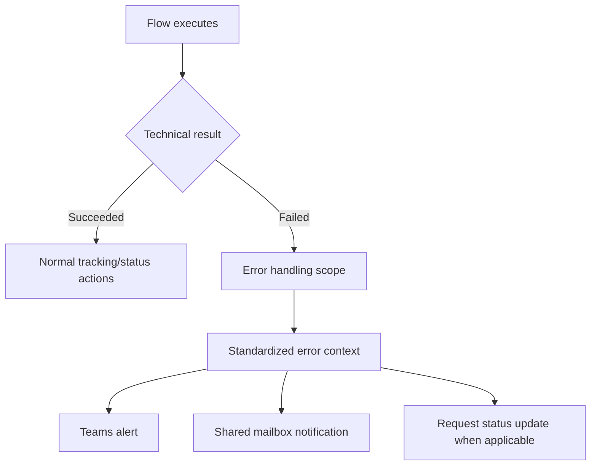

# Error Handling, Monitoring, and Notifications

[← Back to project overview](../README.md)

## Objective

Avoid silent failures and make issues visible to the people responsible for supporting the automation.

## Standard flow structure

Each flow follows a consistent pattern using:

- `Scope - Main`
- `Scope - Error Handling`

This organizes normal processing separately from exception handling. The exact run-after configuration is not published.

## Context variables

| Variable | Purpose |
| --- | --- |
| `vFlowName` | Identify the flow associated with the alert. |
| `vEnvironment` | Identify the logical DEV or PRD context. |
| `vArea` | Identify the business area (for example HR or Operations). |

## Monitoring pattern

## Operational responsibilities

- Capture useful execution context for troubleshooting.
- Return a standardized failure result where applicable.
- Notify support through Teams and/or email.
- Update SharePoint status when the process requires it.
- Preserve a distinction between approval rejection and technical execution failure.

## Communication channels

- **Microsoft Teams:** operational visibility and automation alerts.
- **Outlook/shared mailbox:** targeted notifications and a monitored communication channel.
- **SharePoint:** business-level status and request history.

The source documentation identifies these channels but does not specify guaranteed delivery, retry counts, or incident response SLAs.

## Future improvements

- Dedicated flow-log list for centralized events.
- Retry handling for transient failures.
- Monitoring dashboard with Power BI.
- More explicit exception categorization and support procedures.

These items are roadmap opportunities, not completed functionality.

## Related documentation

- [Architecture](architecture.md)
- [State management](state-management.md)
- [Governance](governance.md)
